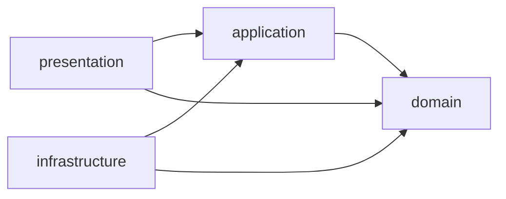

# Architecture Overview

Settlements is a NeoForge Minecraft mod that extends villager life and settlement generation. This is the contributor's
entry point for package ownership, architectural boundaries, and the subsystem guides that own extension recipes.

[SettlementsMod][mod-entry] is the mod entry point. The standards in [docs/standards](../standards/) own Java, testing,
documentation, platform, and UX conventions.

## Intended dependency direction

Design toward a pure Java domain, with dependencies pointing inward. Minecraft and NeoForge adaptation belongs at the
outer boundary so domain rules and values remain independent of engine
APIs. [C1](../standards/code.md#c1--dependency-inversion-wired-by-dagger)
owns interface placement and dependency inversion; the diagram expresses the intended direction for new work.

A representative boundary is [BuildingRegistry][building-registry], supplied by
[BuildingDefinitionDataManager][building-data] through [WorldGenerationModule][worldgen-module]. Generation consumes
the registry contract while the adapter owns datapack loading. Ports also belong in application when that is the
consuming layer; [InferenceTransport][inference-transport] is an example.

## Package responsibilities

All package links below are under `dev.breezes.settlements`. This map describes ownership; subsystem guides link to
the current implementations and registration seams.

| Package | Responsibility | Entry point |
|---|---|---|
| [domain][domain-package] | Gameplay rules, contracts, models, and value objects. | [BuildingRegistry][building-registry] |
| [application][application-package] | Feature orchestration: behavior execution, catalog resolution, sensing, sessions, and server UI services. | [VillagerBrain][villager-brain], [BehaviorPoolResolver][pool-resolver] |
| [infrastructure][infrastructure-package] | Minecraft and NeoForge adapters, entities, datapack loading, config, networking, rendering, and world-generation integration. | [BaseVillager][base-villager], [BuildingDefinitionDataManager][building-data] |
| [presentation][presentation-package] | Player-facing entry points, including client screens and HUDs, client state, and server commands. | [UI][ui-package], [commands][command-package] |
| [bootstrap][bootstrap-package] | Lifecycle and event integration, platform registration, and deferred registries. | [events][event-package], [registries][registry-package] |
| [di][di-package] | Component composition, bindings, scopes, and the bridge for objects constructed outside Dagger. | [SettlementsDagger][dagger-bridge] |
| [shared][shared-package] | Utilities and annotations used across features. | [logging][logging-package], [utilities][utilities-package] |

Package placement does not determine logical side, execution thread, or object lifetime.

## Runtime boundaries

**Server state and client presentation.** Gameplay state is authoritative on the server. Client screens and renderers
consume synchronized projections rather than resolving server-owned services. The behavior-status UI is a representative
[snapshot boundary](behavior_system.md#behavior-status-ui). Root-graph placement does not make server-loaded datapack
data
available on the client; [P2](../standards/platform.md#p2--datapack-backed-registries-do-not-exist-on-the-client) owns
that trap.

**Live world and worker inputs.** Planning and resource-scanning workers consume snapshots captured on the server
thread.
Keep live-world access at that boundary; the [planning and sensing guide](behavior_system.md#opportunity-forecasting)
explains the constraints. Moving work to a worker requires deciding what can be captured safely before dispatch.

**Process, world, and connection lifetimes.** The [Dagger Guide](dagger_guide.md) owns graph construction, scope
selection,
and cleanup. Entity construction has additional timing and logical-side restrictions under
[P1](../standards/platform.md#p1--entity-constructors-run-on-both-logical-sides).
Custom side annotations document intent; platform entry points still need the appropriate side guards.

Nullability and constructor conventions belong to the [Code Standard](../standards/code.md), including
[C4](../standards/code.md#c4--absence-contracts). Tool defaults require their own configuration to reflect those
conventions.

## Find the guide for your change

| Change | Guide |
|---|---|
| Dependency bindings, configs, packets, or graph lifecycle | [Dagger Guide](dagger_guide.md) |
| Behavior registration, planning, sensors, or memory | [Behavior System](behavior_system.md) |
| Day-plan execution, overrides, social cues, or vanilla activity arbitration | [Behavior Orchestration](behavior_orchestration.md) |
| Danger assessment, fighting, or fleeing | [Threat Response](threat_response.md) |
| Datapack loaders and their validation boundaries | [Datapack System](datapack_system.md) |
| Settlement records, founding, membership, or lifecycle | [Settlement Identity and Lifecycle](settlements.md) |
| Settlement generation | [Generation Overview](generation/overview.md), [Pipeline](generation/pipeline.md), [Minecraft Integration](generation/minecraft_integration.md) |
| Animation, locomotion, models, or rendered attachments | [Animation System](animation_system.md), [Animation Import](animation_import_blockbench.md), [Model Tuning](animation_model_tuning.md) |
| HUD regions, previews, or entity highlights | [Player Surfaces](player_surfaces.md) |
| Log lines: loggers, categories, severities, exceptions, or argument cost | [Logging Conventions](logging_conventions.md) |
| Test graph setup and test construction | [Testing Guide](testing_guide.md) |

Extension recipes belong in the subsystem guide beside the boundaries they connect. Follow its source links to the
registry or module that owns the current set of implementations.

[mod-entry]: ../../src/main/java/dev/breezes/settlements/SettlementsMod.java
[domain-package]: ../../src/main/java/dev/breezes/settlements/domain/
[application-package]: ../../src/main/java/dev/breezes/settlements/application/
[infrastructure-package]: ../../src/main/java/dev/breezes/settlements/infrastructure/
[presentation-package]: ../../src/main/java/dev/breezes/settlements/presentation/
[bootstrap-package]: ../../src/main/java/dev/breezes/settlements/bootstrap/
[di-package]: ../../src/main/java/dev/breezes/settlements/di/
[shared-package]: ../../src/main/java/dev/breezes/settlements/shared/
[building-registry]: ../../src/main/java/dev/breezes/settlements/domain/generation/building/BuildingRegistry.java
[building-data]: ../../src/main/java/dev/breezes/settlements/infrastructure/minecraft/data/building/BuildingDefinitionDataManager.java
[worldgen-module]: ../../src/main/java/dev/breezes/settlements/di/modules/WorldGenerationModule.java
[inference-transport]: ../../src/main/java/dev/breezes/settlements/application/ai/inference/InferenceTransport.java
[villager-brain]: ../../src/main/java/dev/breezes/settlements/application/ai/brain/VillagerBrain.java
[pool-resolver]: ../../src/main/java/dev/breezes/settlements/application/ai/catalog/BehaviorPoolResolver.java
[base-villager]: ../../src/main/java/dev/breezes/settlements/infrastructure/minecraft/entities/villager/BaseVillager.java
[ui-package]: ../../src/main/java/dev/breezes/settlements/presentation/ui/
[command-package]: ../../src/main/java/dev/breezes/settlements/presentation/commands/
[event-package]: ../../src/main/java/dev/breezes/settlements/bootstrap/event/
[registry-package]: ../../src/main/java/dev/breezes/settlements/bootstrap/registry/
[dagger-bridge]: ../../src/main/java/dev/breezes/settlements/di/SettlementsDagger.java
[logging-package]: ../../src/main/java/dev/breezes/settlements/shared/logging/
[utilities-package]: ../../src/main/java/dev/breezes/settlements/shared/util/
