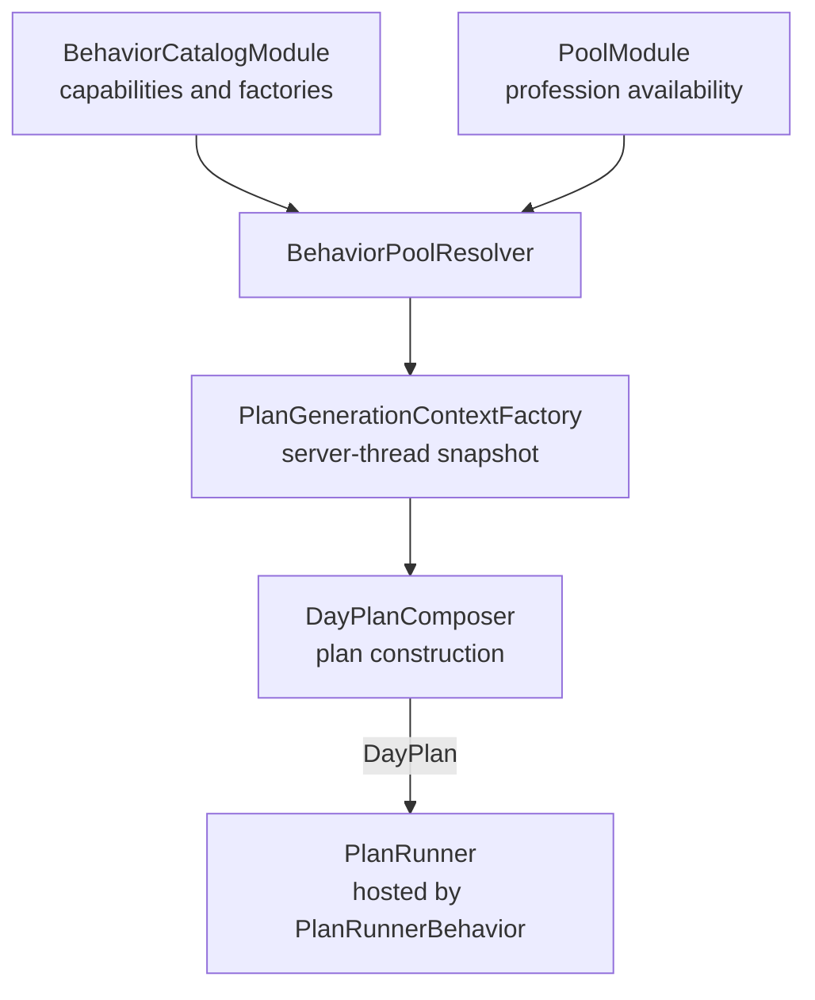

# Behavior System

This reference explains how behavior registration, planning, execution, sensors, and memory fit together. For dependency
injection, see the [Dagger Guide](dagger_guide.md). For activity selection and runtime arbitration, see
[Behavior Orchestration](behavior_orchestration.md).

Extension checklists: [behavior](#adding-a-new-behavior), [block resource](#adding-a-block-resource),
[sensor](#adding-a-sensor), and [memory](#adding-a-memory).

## Overview

Adult villagers execute scheduled work through a per-villager day plan. The Settlements runtime drives those behaviors
directly; vanilla's weighted behavior selection does not choose them. The vanilla brain hosts the runtime and supplies
reflexes, reactive activities, and ambient life. Babies retain vanilla scheduling.

The scheduled-behavior pipeline separates capability registration, profession availability, plan construction, and
execution:

Sensors supply remembered world state to both behavior preconditions and planning.

## Stage 1 — Registration

The catalog describes capabilities independently of profession availability. Keeping those concerns separate lets
professions share a behavior without duplicating its implementation or planning metadata.

### The catalog — `BehaviorCatalogModule`

[BehaviorCatalogModule][catalog-module] owns catalog bindings. [BehaviorCatalogEntry][catalog-entry] joins a behavior's
planning metadata, display metadata, and factory. [IBehaviorCatalog][catalog-contract] owns the lookup and fresh-instance
contracts; [BehaviorCatalogImpl][catalog-impl] owns construction validation.

Use the module's `harvestPumpkin` binding as a representative entry. Metadata contracts are declared in
[BehaviorPlanningMetadata][planning-metadata] and [BehaviorDisplayMetadata][display-metadata].

### The pools — `PoolModule`

[PoolModule][pool-module] owns profession-specific availability through [ProfessionBehaviorPool][profession-pool]. Its
`farmerPool` binding is a representative extension point. Universal availability belongs in
[BehaviorPoolResolver.UNIVERSAL_ENTRIES][pool-resolver], rather than being copied into each profession's pool.

### `BehaviorKey`

[BehaviorKey][behavior-key] supplies the identity shared by catalog entries, availability mappings, plan slots, and
display-name lookup. Adding a behavior requires wiring the same key across those boundaries.

## Stage 2 — Resolution

[BehaviorPoolResolver][pool-resolver] joins profession and universal availability against catalog metadata for planning.
Day-type policy belongs to plan construction, so a behavior's inclusion in the resolved pool is not permission to
schedule it in every context.

**The wiring trap:** Dagger validates dependency bindings, but does not establish that pool keys resolve to catalog
entries. An unresolved pool key is dropped during resolution without a warning; a catalog entry with no availability
mapping cannot be selected by ordinary pool-based planning. Reactive-only catalog behaviors intentionally omit that
mapping. Check the activation path when deciding whether an absent pool entry is a defect.

## Stage 3 — Planning

[IPlanGenerator][plan-generator] is the plan-generation contract. [DayPlanComposer][plan-composer] owns schedule boundaries,
anchors, and gap filling; [WindowPacker][window-packer] owns slot packing. The heuristic and LLM overlay paths share that
composition, while [PlanIntent][plan-intent] selects different candidate-selection policies. An explicit overlay choice
can bypass the heuristic's band and rest-day weighting, so shared composition does not imply identical selection rules.

Behavior cadence is scheduled between slots. Each run receives a fresh behavior instance, so instance cooldowns cannot
enforce spacing between runs. Keep this boundary when changing either packing or execution; the startup rationale lives
beside `PlanRunner.tryStartSlot` in [PlanRunner][plan-runner].

Category and intensity shape heuristic candidate pools and rest-day weights. They are not runtime permission checks.
Consult [PlannerPolicy][planner-policy] and [RestDayPolicy][rest-day-policy] when choosing them; a pastime intended for
nitwits should be categorized as leisure rather than work.

### Plan data structures (`domain/ai/planning/`)

[DayPlan][day-plan] and [PlanSlot][plan-slot] own plan identity, slot coordinates, and lifecycle contracts. Scheduling uses
the midnight-based day defined by [CivilTime][civil-time], rather than Minecraft's dawn-based day boundary. Preserve that
distinction when relating a plan's calendar day to world time.

Slot durations and elapsed runtime ceilings use different time domains. The conversion contracts belong to
[GameTicks][game-ticks], [ClockTicks][clock-ticks], and [BehaviorPlanningMetadata][planning-metadata].

### Opportunity forecasting

[OpportunityForecaster][opportunity-forecaster] evaluates declared opportunities while
[PlanGenerationContextFactory][context-factory] builds the planning snapshot. This is server-thread work: reading
decaying spatial memory can expire entries. Planning receives captured values instead of accessing live villager or
world state from its worker thread.

Lacking an opportunity reduces heuristic selection weight instead of excluding the behavior, allowing plans to remain
useful when better candidates are unavailable. Explicit overlay preferences use a different selection policy. In either
path, the behavior checks live preconditions when execution starts because the world may have changed since forecasting.

### Async path, the LLM overlay, and storage

[HeuristicAsyncPlanGenerator][async-generator] supplies background heuristic generation.
[PlanRequestService][plan-request-service] supplies the optional LLM overlay. Requests proceed independently; arrival
order is not guaranteed. [PlanRunner][plan-runner] owns arrival arbitration, adoption, and fallback. See
[Context-Aware Planning](behavior_orchestration.md#context-aware-planning-foreground-shaping) for the runtime handoff.

The day plan is reload-transient state on [BaseVillager][base-villager]. Reloading regenerates a plan rather than restoring
its cursor or commitments. Regeneration within the same loaded day can carry future pinned commitments; the retention
rules and fallback limitations belong to `PlanRunner.collectCarriedPins` and `regeneratePlan`.

## Stage 4 — Execution

[PlanRunnerBehavior][runner-host] hosts the adult runtime in vanilla CORE so activity transitions do not destroy its
coordination point. [PlanRunner][plan-runner] executes scheduled slots; [OverrideArbiter][override-arbiter] coordinates
reactive execution. The host evaluates overrides before the plan's activity gate, allowing admitted reactive work to run
even when scheduled work is suspended.

Activity selection belongs to [ActivityArbiter][activity-arbiter]. Its decision precedes the vanilla brain tick so the
execution gate and vanilla packages use the current context. The precedence and preemption rules belong in
[Activity Arbitration](behavior_orchestration.md#activity-arbitration) and the
[Reactive Override Lane](behavior_orchestration.md#reactive-override-lane).

### The `PLAN_BEHAVIOR_ACTIVE` latch

`PLAN_BEHAVIOR_ACTIVE` is derived, never set by the lane that starts work. `PlanRunnerBehavior` recomputes it after
every tick branch (and on `stop()`) from `BaseVillager.hasActiveExecution()` — present while a day-plan behavior runs
or an override is installed, absent otherwise. Its consumer is
`AmbientBehaviors.gated(...)`, which wraps a vanilla behavior in a `GateBehavior` requiring `PLAN_BEHAVIOR_ACTIVE` to
be **absent**. It wraps most of vanilla ambient life and the raid packages' movement behaviors
([`behavior_orchestration.md`](behavior_orchestration.md#reactive-and-baby-activities)). So the memory is the
mutual-exclusion latch: while a Settlements behavior or override runs, the vanilla behaviors it gates are suppressed.

**Bound navigation work.** A stalled behavior occupies execution and delays the remaining plan until the runtime ceiling
ends it. Navigation steps need bounded completion and either target reselection or clean failure; use
[NavigateToTargetStep][navigation-step] and [HarvestPumpkinBehavior][pumpkin-behavior] as source references. A reactive
interruption stops the current instance and requeues its slot, which may be tried with a fresh instance while its window
remains open. It does not resume the interrupted instance.

## Vanilla brain integration that remains

[BaseVillager][base-villager] owns brain registration and the AI-step integration. Adult ambient packages live in
[VanillaAmbientBehaviorPackages][ambient-packages]; reactive and baby packages live in
[VanillaBehaviorPackages][vanilla-packages]. These are mod-owned package definitions because activity selection and
execution ownership differ from vanilla's wiring. Package membership belongs in those source files.

Goal replacement must wait until the server graph is available. Vanilla constructs an initial brain before that graph
can be resolved; the server-side join hook covers freshly spawned villagers as well as loaded ones. Preserve this
lifecycle boundary when changing brain initialization; see `BaseVillager.onAddedToLevel` and
[P1](../standards/platform.md#p1--entity-constructors-run-on-both-logical-sides).

**Bed ownership spans claim arbitration and validation.** A losing claimant must not release the reservation backing the
winner, and an occupied bed must not be treated as unclaimed. [BedCompetitorScan][bed-competitor] and
[ValidateNearbyHome][home-validator] own the respective contracts. Keep those contracts together when editing CORE and
REST wiring; replacing the HOME validator with vanilla's `ValidateNearbyPoi` can release a sleeper's reservation and
admit another claimant.

## Sensors (the read side)

The two sensor frameworks have different construction boundaries:

- Mod-native [AbstractSensor][abstract-sensor] instances come from injected factories in
  [SensorCatalogModule][sensor-module] after server-side entity initialization. Use this framework for new senses that
  need injected configuration or services.
- Vanilla sensors are constructed with the brain. Their construction cannot resolve server-owned dependencies; see P1
  above.

[VillagerBrain][villager-brain] owns the custom-sensor lifecycle. Custom sensing follows the vanilla AI step, making the
result available to subsequent planning and behavior ticks.

Block-state resources share [WorldResourceIndex][resource-index] and [BlockResourceSensor][resource-sensor]. Live-world
snapshots are captured on the server thread; matching runs against copied state off-thread through
[ResourceIndexRefresher][index-refresher]. Adding a resource extends the shared pipeline instead of adding another scan.
A sense that needs block-entity data, such as cultivation-lily validity, needs its own sensor.

### Adding a block resource

1. Add a matcher in [BlockMatchers][block-matchers]. Use `HARVESTABLE_PUMPKIN` as a representative state-and-neighbor
   predicate; [BlockMatcher][block-matcher] owns the predicate contracts.
2. Declare a decaying site memory through [Adding a memory](#adding-a-memory).
3. Add a `BlockResource` multibinding in [SensorCatalogModule][sensor-module]; `ripePumpkin` is the representative binding.
4. Connect a behavior to that memory. [KnownBlockSitesPrecondition][site-precondition] and
   [BlockMemoryTargetResolver][site-resolver] are the entry points for remembered block targets.

### Adding a sensor

1. Implement a mod-native sensor and provide its `ConfigurationType.SENSOR` config through
   [Adding a config](dagger_guide.md#adding-a-config).
2. Bind its `VillagerSensorFactory` in [SensorCatalogModule][sensor-module] with `@BaseLane`, or `@CognitionScoped` when
   the sense is needed only with inference enabled. An unqualified binding conflicts with the module's merged-set
   provider. Keep the qualifier so the inference gate controls the intended lane.
3. Register the memory it writes through [Adding a memory](#adding-a-memory).
4. Verify that observations appear and clear under the expected world conditions, including with inference disabled for
   a base-lane sensor. Dependency validation alone cannot establish that sensing and memory wiring agree.

A vanilla sensor instead needs a type in [SensorTypeRegistry][sensor-registry] and inclusion in `BaseVillager.sensorTypes`.

## Villager memory

Choose storage according to who can reconstruct the fact and who consumes it:

| Memory kind | Use when | Persistence |
|---|---|---|
| Vanilla-backed | Vanilla brain machinery needs the value, or the value does not need spatial decay | Requires a codec on its `MemoryModuleType` |
| Decaying spatial | Sensed sites should expire and remain bounded | Transient; sensing rebuilds it after reload |

[MemoryType][memory-type] owns the memory and write contracts. [MemoryTypeRegistry][memory-registry] owns declarations;
[MemoryModuleTypeRegistry][memory-module-registry] owns vanilla module registration and codecs;
[SettlementsMemoryStore][memory-store] owns decaying storage. Read those declarations for payload types, expiry, caps,
and supported writes.

Remembered ownership differs from a rediscoverable world site. Taming establishes an owned-pet relationship; nearby
sensing cannot reliably recover the complete ownership list when pets are distant or unloaded. A brain memory carrying
such a fact needs a codec. For persistent non-memory entity state, follow
[P17](../standards/platform.md#p17--an-entitys-attachments-are-written-before-addadditionalsavedata) instead of creating a
second authoritative copy.

**Spatial-memory identifiers cross the SIS boundary.** [SensedSiteReader][sensed-site-reader] exposes the types in
`MemoryTypeRegistry.spatialSiteTypes` to planning and snapshots. [SnapshotAssembler][snapshot-assembler] derives wire
tokens from their identifiers; its `toWireToken` contract owns the mapping. Coordinate identifier additions and renames
with the SIS vocabulary that consumes those tokens. This applies to the exposed spatial types, rather than every memory
whose payload happens to be a list of positions.

### Adding a memory

For vanilla-backed memory:

1. Register its module in [MemoryModuleTypeRegistry][memory-module-registry], supplying a codec if it must survive reload.
2. Declare its wrapper in [MemoryTypeRegistry][memory-registry].
3. Include the module in `BaseVillager.memoryTypes` so the brain knows it. Genuinely unregistered memories silently lose
   writes and fail on reads; declaring a wrapper alone does not register the vanilla storage.

For decaying spatial memory:

1. Declare it in [MemoryTypeRegistry][memory-registry]. Choose retention from how long an observation stays actionable,
   and capacity from the candidate sites consumers need.
2. Include it in `MemoryTypeRegistry.decayingSpatialTypes` so [SensedSiteReader][sensed-site-reader] exposes it to planning
   and SIS snapshots. Follow the identifier contract above.

Decaying memory uses the mod's store and needs no vanilla memory-module registration.

## Behavior-status UI

The Day Plan screen receives snapshots of schedule state, rather than sharing live behavior instances with the client.
Start with [DayPlanSnapshotAssembler][snapshot-ui] for the server projection,
[DayPlanSnapshotPublisher][snapshot-publisher] for publication, and [DayPlanScreen][day-plan-screen] for presentation.
Catalog display metadata and localization connect a registered behavior to that projection.

## Adding a new behavior

Choose the activation path before wiring availability:

| Activation | Wiring |
|---|---|
| Scheduled slot | Catalog entry plus profession or universal availability |
| Reactive catalog behavior | Catalog entry plus an [override policy](behavior_orchestration.md#adding-a-reactive-override); omit pool membership for reactive-only work |
| Combat action | A [combat option](threat_response.md#adding-a-combat-option) creates the action for the combat runner |

For a catalog behavior:

1. Add its config and provide it through [Adding a config](dagger_guide.md#adding-a-config).
   [HarvestPumpkinConfig][pumpkin-config] shows the behavior-specific pattern; [BehaviorTimingConfig][timing-config],
   [BehaviorConfigConstants][config-constants], and [BehaviorCooldownValidator][cooldown-validator] own its timing,
   shared identifiers, and validation contracts.
2. Implement the behavior with [VillagerStateMachineBehavior][villager-behavior] and [BehaviorSupport][behavior-support].
   [IBehavior][behavior-contract] owns the lifecycle contract; [HarvestPumpkinBehavior][pumpkin-behavior] is a representative
   implementation. Follow [Bound navigation work](#the-plan_behavior_active-latch) when constructing its steps.
3. Add its identity in [BehaviorKey][behavior-key].
4. Add its entry in [BehaviorCatalogModule][catalog-module], including planning and display metadata. Use the
   [planning guidance](#stage-3--planning) when choosing category, intensity, cadence, and opportunity requirements.
   For interruption semantics, consult the [Reactive Override Lane](behavior_orchestration.md#reactive-override-lane).
5. Add the display-name key to the [language resources][language-resources]. Confirm that the screen shows a translated
   name and the intended icon.
6. For scheduled work, add profession availability in [PoolModule][pool-module], or universal availability in
   [BehaviorPoolResolver][pool-resolver]. For reactive-only work, wire its policy instead.
7. Compile to validate dependency wiring, then exercise the activation path in-game. For scheduled work, confirm both
   plan inclusion and successful execution; for reactive work, trigger its stimulus. Check unavailable opportunities,
   interruption, and unreachable targets so wiring success does not hide a behavior that cannot make progress.

[catalog-module]: ../../src/main/java/dev/breezes/settlements/di/modules/server/BehaviorCatalogModule.java
[catalog-entry]: ../../src/main/java/dev/breezes/settlements/di/catalog/BehaviorCatalogEntry.java
[catalog-contract]: ../../src/main/java/dev/breezes/settlements/domain/ai/catalog/IBehaviorCatalog.java
[catalog-impl]: ../../src/main/java/dev/breezes/settlements/application/ai/catalog/BehaviorCatalogImpl.java
[planning-metadata]: ../../src/main/java/dev/breezes/settlements/domain/ai/catalog/BehaviorPlanningMetadata.java
[display-metadata]: ../../src/main/java/dev/breezes/settlements/domain/ai/catalog/BehaviorDisplayMetadata.java
[pool-module]: ../../src/main/java/dev/breezes/settlements/di/modules/server/PoolModule.java
[profession-pool]: ../../src/main/java/dev/breezes/settlements/domain/ai/catalog/ProfessionBehaviorPool.java
[pool-resolver]: ../../src/main/java/dev/breezes/settlements/application/ai/catalog/BehaviorPoolResolver.java
[behavior-key]: ../../src/main/java/dev/breezes/settlements/domain/ai/catalog/BehaviorKey.java
[plan-generator]: ../../src/main/java/dev/breezes/settlements/domain/ai/planning/IPlanGenerator.java
[plan-composer]: ../../src/main/java/dev/breezes/settlements/application/ai/planning/DayPlanComposer.java
[window-packer]: ../../src/main/java/dev/breezes/settlements/application/ai/planning/WindowPacker.java
[plan-intent]: ../../src/main/java/dev/breezes/settlements/domain/ai/planning/PlanIntent.java
[plan-runner]: ../../src/main/java/dev/breezes/settlements/application/ai/planning/PlanRunner.java
[planner-policy]: ../../src/main/java/dev/breezes/settlements/application/ai/planning/PlannerPolicy.java
[rest-day-policy]: ../../src/main/java/dev/breezes/settlements/domain/ai/schedule/RestDayPolicy.java
[day-plan]: ../../src/main/java/dev/breezes/settlements/domain/ai/planning/DayPlan.java
[plan-slot]: ../../src/main/java/dev/breezes/settlements/domain/ai/planning/PlanSlot.java
[civil-time]: ../../src/main/java/dev/breezes/settlements/domain/time/CivilTime.java
[game-ticks]: ../../src/main/java/dev/breezes/settlements/domain/time/GameTicks.java
[clock-ticks]: ../../src/main/java/dev/breezes/settlements/domain/time/ClockTicks.java
[opportunity-forecaster]: ../../src/main/java/dev/breezes/settlements/application/ai/planning/OpportunityForecaster.java
[context-factory]: ../../src/main/java/dev/breezes/settlements/application/ai/planning/PlanGenerationContextFactory.java
[async-generator]: ../../src/main/java/dev/breezes/settlements/application/ai/planning/HeuristicAsyncPlanGenerator.java
[plan-request-service]: ../../src/main/java/dev/breezes/settlements/application/ai/planning/PlanRequestService.java
[base-villager]: ../../src/main/java/dev/breezes/settlements/infrastructure/minecraft/entities/villager/BaseVillager.java
[runner-host]: ../../src/main/java/dev/breezes/settlements/infrastructure/minecraft/behavior/planning/PlanRunnerBehavior.java
[override-arbiter]: ../../src/main/java/dev/breezes/settlements/application/ai/override/OverrideArbiter.java
[activity-arbiter]: ../../src/main/java/dev/breezes/settlements/application/ai/brain/ActivityArbiter.java
[navigation-step]: ../../src/main/java/dev/breezes/settlements/application/ai/behavior/workflow/steps/concrete/NavigateToTargetStep.java
[pumpkin-behavior]: ../../src/main/java/dev/breezes/settlements/application/ai/behavior/usecases/villager/farming/HarvestPumpkinBehavior.java
[ambient-packages]: ../../src/main/java/dev/breezes/settlements/application/ai/brain/VanillaAmbientBehaviorPackages.java
[vanilla-packages]: ../../src/main/java/dev/breezes/settlements/application/ai/brain/VanillaBehaviorPackages.java
[bed-competitor]: ../../src/main/java/dev/breezes/settlements/infrastructure/minecraft/behavior/home/BedCompetitorScan.java
[home-validator]: ../../src/main/java/dev/breezes/settlements/infrastructure/minecraft/behavior/home/ValidateNearbyHome.java
[abstract-sensor]: ../../src/main/java/dev/breezes/settlements/application/ai/sensors/AbstractSensor.java
[sensor-module]: ../../src/main/java/dev/breezes/settlements/di/modules/server/SensorCatalogModule.java
[sensor-registry]: ../../src/main/java/dev/breezes/settlements/bootstrap/registry/sensors/SensorTypeRegistry.java
[villager-brain]: ../../src/main/java/dev/breezes/settlements/application/ai/brain/VillagerBrain.java
[resource-index]: ../../src/main/java/dev/breezes/settlements/application/ai/sensors/WorldResourceIndex.java
[resource-sensor]: ../../src/main/java/dev/breezes/settlements/application/ai/sensors/BlockResourceSensor.java
[index-refresher]: ../../src/main/java/dev/breezes/settlements/application/ai/sensors/ResourceIndexRefresher.java
[block-matchers]: ../../src/main/java/dev/breezes/settlements/domain/world/blocks/BlockMatchers.java
[block-matcher]: ../../src/main/java/dev/breezes/settlements/domain/world/blocks/BlockMatcher.java
[site-precondition]: ../../src/main/java/dev/breezes/settlements/domain/ai/conditions/KnownBlockSitesPrecondition.java
[site-resolver]: ../../src/main/java/dev/breezes/settlements/application/ai/targeting/BlockMemoryTargetResolver.java
[memory-type]: ../../src/main/java/dev/breezes/settlements/domain/ai/memory/MemoryType.java
[memory-registry]: ../../src/main/java/dev/breezes/settlements/domain/ai/memory/MemoryTypeRegistry.java
[memory-module-registry]: ../../src/main/java/dev/breezes/settlements/bootstrap/registry/memory/MemoryModuleTypeRegistry.java
[memory-store]: ../../src/main/java/dev/breezes/settlements/domain/ai/memory/SettlementsMemoryStore.java
[sensed-site-reader]: ../../src/main/java/dev/breezes/settlements/application/ai/memory/SensedSiteReader.java
[snapshot-assembler]: ../../src/main/java/dev/breezes/settlements/application/ai/inference/monologue/SnapshotAssembler.java
[snapshot-ui]: ../../src/main/java/dev/breezes/settlements/application/ui/dayplan/DayPlanSnapshotAssembler.java
[snapshot-publisher]: ../../src/main/java/dev/breezes/settlements/application/ui/dayplan/DayPlanSnapshotPublisher.java
[day-plan-screen]: ../../src/main/java/dev/breezes/settlements/presentation/ui/dayplan/DayPlanScreen.java
[pumpkin-config]: ../../src/main/java/dev/breezes/settlements/application/ai/behavior/usecases/villager/farming/HarvestPumpkinConfig.java
[timing-config]: ../../src/main/java/dev/breezes/settlements/application/ai/behavior/runtime/timing/BehaviorTimingConfig.java
[config-constants]: ../../src/main/java/dev/breezes/settlements/application/config/constants/BehaviorConfigConstants.java
[cooldown-validator]: ../../src/main/java/dev/breezes/settlements/application/config/validation/BehaviorCooldownValidator.java
[villager-behavior]: ../../src/main/java/dev/breezes/settlements/application/ai/behavior/runtime/VillagerStateMachineBehavior.java
[behavior-support]: ../../src/main/java/dev/breezes/settlements/application/ai/behavior/runtime/BehaviorSupport.java
[behavior-contract]: ../../src/main/java/dev/breezes/settlements/domain/ai/behavior/contracts/IBehavior.java
[language-resources]: ../../src/main/resources/assets/settlements/lang/
