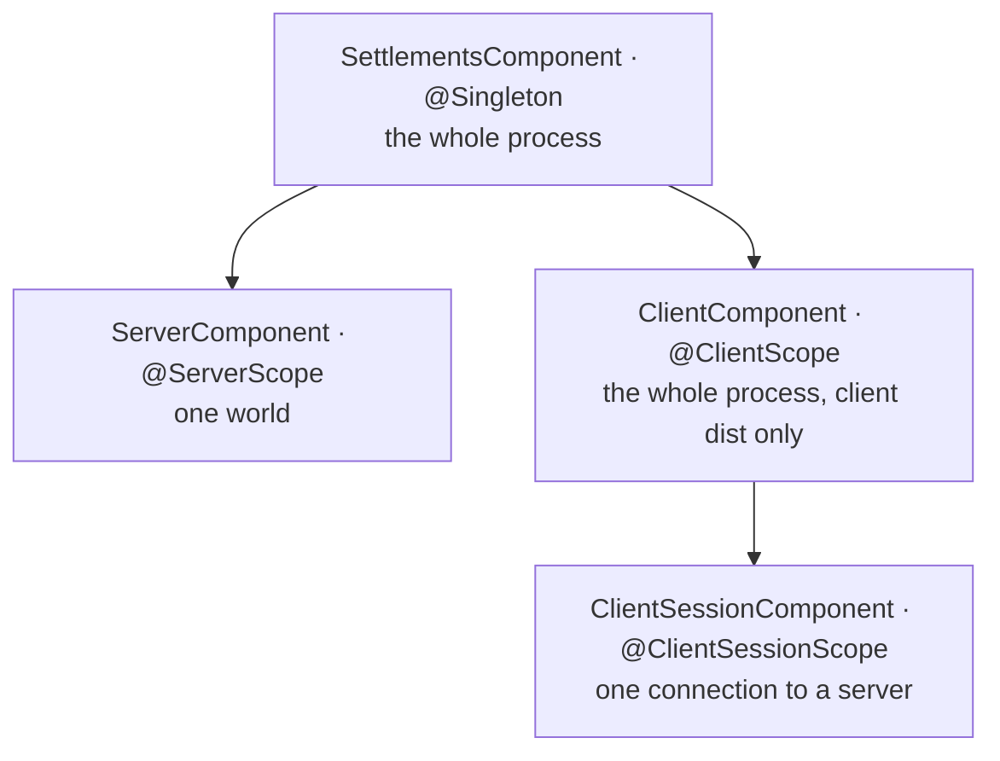

# Dagger Dependency Injection Guide

How the Dagger graph is shaped, where a new binding belongs, how code that Minecraft constructs reaches the graph, and
what each part of the graph's lifetime obliges. For the layers the graph wires together, see
[Architecture Overview](architecture_overview.md); for the test graph, see [Testing Guide](testing_guide.md).

---

## Component hierarchy

One root component and three subcomponents separate process, world, and connection lifetimes. The component interfaces
linked in [Lifecycle](#lifecycle) own their installed modules and external entry points.

A dedicated server never builds a `ClientComponent`, and a client connected to a remote server has no `ServerComponent`.

Scoped bindings share one instance within their owning component instance. Server and client-session components are
recreated with their world or connection; references held elsewhere still need [cleanup](#what-server-stop-must-undo).

### Choosing a scope

Keep shared state in the shortest-lived component that covers its intended users.

- **Root** — services used on both logical sides or needed before a world loads, such as config bindings and reload
  listeners. Placement here does not make server-loaded datapack data available on the client; see
  [P2](../standards/platform.md#p2--datapack-backed-registries-do-not-exist-on-the-client).
- **Server** — services shared by one world's gameplay, such as planning, session registries, and server event handlers.
- **Client** — process-lived client services, such as renderers and client-bound packet handlers.
- **Client session** — objects used within one connection.

A parent component cannot inject its subcomponent's bindings. A renderer or packet handler owned by `ClientComponent`
therefore cannot constructor-inject a session-scoped object; it must resolve that object
[at the point of use](#reaching-the-graph-from-code-minecraft-constructs).

Per-connection state retained by a client-scoped service needs an explicit reset. Such a service implements
[ClientSessionResettable][session-resettable] and contributes to the set in [ClientLifecycleModule][client-lifecycle].
Discarding the session component does not clear state held by client singletons, so omitting that contribution carries
one server's state into the next connection.

---

## Bindings

### Implicit bindings

A class with an `@Inject` constructor needs no module entry for its unqualified concrete binding. Constructor conventions
belong to [C3](../standards/code.md#c3--constructor-injection).

State alone does not justify a component scope. An unscoped constructor binding creates a fresh object when requested,
which is appropriate for state owned by one entity or execution. [PlanRunnerBehavior][plan-runner-behavior], for example,
is obtained per villager through the provider exposed by [ServerComponent][server-component].

### Modules

Use `@Provides` for factory-created values or external types, and `@Binds` for interface or qualified aliases. Both can
carry qualifiers. For library semantics, see [Dagger's binding guide](https://dagger.dev/dev-guide/basic-usage).

Modules live under `di/modules/`, with `server/` and `client/` holding the subcomponents' modules. The root graph has a
module per domain area that exposes datapack loaders through the domain registry interfaces they implement, while
[DataManagerModule][data-manager-module] provides the concrete loaders; the
[Datapack System](datapack_system.md#adding-a-new-loader) recipe walks both.

Install a module in its owning component, directly or through an installed module's `includes`. An omitted multibinding
module can leave contributions silently missing even when the graph still compiles.

### Multibindings are the extension points

Multibindings let modules contribute `@IntoSet` or `@IntoMap` entries without changing the consumer. Subsystem recipes
name the owning module. Two patterns need special care:

- **Qualified sets.** Some sets are split by a qualifier — a base set and a set that applies only with inference on,
  for instance — and a `@Provides` method joins them into the unqualified set consumers inject. Contribute with the
  qualifier the owning module uses; the merged binding centralizes the inference gate. An unqualified `@IntoSet`
  contribution collides with that provider. [SensorCatalogModule][sensor-catalog] is an example.
- **Ranked lists.** Where order carries meaning, the module provides an ordered `List` rather than a set, and a new
  member is placed by hand at its rank. [OverridePolicyModule][override-policies] is an example.

### Qualifiers and Lombok

[C1](../standards/code.md#c1--dependency-inversion-wired-by-dagger) owns qualifier propagation rules, their exceptions,
and the silent misbinding trap. [lombok.config][lombok-config] owns the copied-annotation list; qualifier declarations
live in `di/`.

---

## Recipes

### Adding a service

1. Add its constructor binding and choose shared or per-use identity
   ([Choosing a scope](#choosing-a-scope), [Implicit bindings](#implicit-bindings)).
2. If it implements a domain interface that callers should depend on, `@Binds` the interface to it in a module of the
   same component.
3. If code outside the graph needs it, add an accessor to the component interface.

### Adding a config

1. Define a record annotated `@BehaviorConfig` for discovery by [ConfigAnnotationProcessor][config-discovery].
   [RecordConfigProcessor][record-config] and the [config annotations][config-annotations] own supported component
   annotations. `ConfigurationType` selects the TOML file; `name` selects the section within it.
2. Add a root binding in [ConfigModule][config-module] that obtains the record from [ConfigFactory][config-factory],
   following an adjacent provider.

Runtime config registration and Dagger binding are separate seams: discovery does not add a graph binding, and a provider
does not register a config. Config records are startup snapshots shared by the graph, so TOML edits require a new launch.
[ConfigFactory][config-factory] is the starting point for missing-config diagnostics. Behavior configs also follow
[Adding a new behavior](behavior_system.md#adding-a-new-behavior).

### Adding a packet

1. Define a record implementing [ServerBoundPacket][server-bound-packet] or [ClientBoundPacket][client-bound-packet],
   with `ID` and `CODEC`, following the layout of a sibling feature.
2. Add its injectable handler using [ServerSidePacketHandler][server-packet-handler] or
   [ClientSidePacketHandler][client-packet-handler].
3. Contribute the class-keyed handler binding in [ServerNetworkModule][server-network] or
   [ClientNetworkModule][client-network], following the module's existing entries.
4. Register the payload and codec in [PacketRegistry][packet-registry].

NeoForge payload registration and the Dagger dispatch map must agree; neither registers the other. A missing handler
triggers a disconnect. [ServerSidePacketReceiver][server-receiver] and [ClientSidePacketReceiver][client-receiver]
own dispatch diagnostics.

Client-bound handlers may use client classes. Both sides load the shared payload types, so keep client classes and
handler references out of packet records.

### Adding a server event handler

1. Make the handler `@ServerScope` with an `@Inject` constructor, and add an accessor to
   [ServerComponent][server-component].
2. Register and unregister it in [ServerLifecycleEvents][server-lifecycle]. A handler that belongs to the inference graph
   goes inside the inference-gate branch in both places.

Why both the scope and the unregister are required is in [What server stop must undo](#what-server-stop-must-undo).

---

## Reaching the graph from code Minecraft constructs

[SettlementsDagger][dagger-bridge] exposes the live graphs to Minecraft-owned objects and static platform callbacks.
Graph-owned services use constructor injection; a bridge lookup is reserved for a dependency the graph cannot hand them,
such as a client-owned service resolving a session-owned object. Expose each externally requested binding through its
component interface.

The bridge owns its accessor API. Choose a throwing lookup when absence is a bug, and a nullable lookup when the path
legitimately runs without that graph, including defensive cleanup.

Resolve world and connection components at the point of use. Caching them in longer-lived objects retains a previous
world or connection; entity construction also has the timing and side restrictions in
[P1](../standards/platform.md#p1--entity-constructors-run-on-both-logical-sides). Root and client graphs remain available
after bootstrap, so constructors reached after that point can use them. Payload registration precedes graph bootstrap,
so registering a callback cannot require a live receiver.

---

## Lifecycle

| Component | Built on | Discarded on | Handler |
|---|---|---|---|
| [SettlementsComponent][root-component] | `FMLLoadCompleteEvent` | never | [CommonModEvents][common-lifecycle] |
| [ClientComponent][client-component] | `FMLLoadCompleteEvent` | never | [CommonModEvents][common-lifecycle] |
| [ServerComponent][server-component] | `ServerAboutToStartEvent` | `ServerStoppedEvent` | [ServerLifecycleEvents][server-lifecycle] |
| [ClientSessionComponent][session-component] | `ClientPlayerNetworkEvent.LoggingIn` | `ClientPlayerNetworkEvent.LoggingOut` | [ClientSessionLifecycleEvents][session-lifecycle] |

### Ordering that matters

- **Config initialization precedes the root graph; the client graph follows the root.** Load-complete tasks populate
  the factory before the graph can resolve config bindings.
- **Reload listeners come from the root component.** When a world loads, `AddReloadListenerEvent` fires before that
  world's `ServerComponent` exists. How the listeners are phased is in
  [Datapack System](datapack_system.md#registration--the-two-phase-intoset-multibinding).
- **Logout resets state held by client-scoped services before discarding the session component.** The client component
  remains alive; [Choosing a scope](#choosing-a-scope) explains why those services need a reset contribution.

### What server stop must undo

The server component is discarded at `ServerStoppedEvent`, but anything it handed to something longer-lived outlives
it unless the stop handler takes it back.

- **Event handlers.** A `@ServerScope` object registered on `NeoForge.EVENT_BUS` at start must be unregistered at
  stop. Left registered, the previous world's instance keeps receiving events alongside the next world's. Unregistering
  works only because the scope makes the accessor return the instance that was registered: an unscoped handler's
  accessor builds a new one, so the unregister call silently does nothing.
- **Executors.** Every server-scoped `ExecutorService` also contributes to the managed-executor set in
  [ConcurrencyModule][concurrency-module], and stop shuts down the whole set. A new pool needs that contribution and no
  lifecycle edit; a pool without it keeps its threads after the world closes.
- **In-flight inference.** With inference on, stop cancels outstanding inference requests before it closes the
  transport they run on.

[root-component]: ../../src/main/java/dev/breezes/settlements/di/SettlementsComponent.java
[server-component]: ../../src/main/java/dev/breezes/settlements/di/ServerComponent.java
[client-component]: ../../src/main/java/dev/breezes/settlements/di/ClientComponent.java
[session-component]: ../../src/main/java/dev/breezes/settlements/di/ClientSessionComponent.java
[dagger-bridge]: ../../src/main/java/dev/breezes/settlements/di/SettlementsDagger.java
[session-resettable]: ../../src/main/java/dev/breezes/settlements/di/ClientSessionResettable.java
[client-lifecycle]: ../../src/main/java/dev/breezes/settlements/di/modules/client/ClientLifecycleModule.java
[plan-runner-behavior]: ../../src/main/java/dev/breezes/settlements/infrastructure/minecraft/behavior/planning/PlanRunnerBehavior.java
[data-manager-module]: ../../src/main/java/dev/breezes/settlements/di/modules/DataManagerModule.java
[sensor-catalog]: ../../src/main/java/dev/breezes/settlements/di/modules/server/SensorCatalogModule.java
[override-policies]: ../../src/main/java/dev/breezes/settlements/di/modules/server/OverridePolicyModule.java
[lombok-config]: ../../lombok.config
[config-discovery]: ../../src/main/java/dev/breezes/settlements/infrastructure/config/annotations/ConfigAnnotationProcessor.java
[record-config]: ../../src/main/java/dev/breezes/settlements/infrastructure/config/annotations/RecordConfigProcessor.java
[config-annotations]: ../../src/main/java/dev/breezes/settlements/infrastructure/config/annotations/
[config-module]: ../../src/main/java/dev/breezes/settlements/di/modules/ConfigModule.java
[config-factory]: ../../src/main/java/dev/breezes/settlements/infrastructure/config/factory/ConfigFactory.java
[server-bound-packet]: ../../src/main/java/dev/breezes/settlements/infrastructure/network/core/ServerBoundPacket.java
[client-bound-packet]: ../../src/main/java/dev/breezes/settlements/infrastructure/network/core/ClientBoundPacket.java
[server-packet-handler]: ../../src/main/java/dev/breezes/settlements/infrastructure/network/core/ServerSidePacketHandler.java
[client-packet-handler]: ../../src/main/java/dev/breezes/settlements/infrastructure/network/core/ClientSidePacketHandler.java
[server-network]: ../../src/main/java/dev/breezes/settlements/di/modules/server/ServerNetworkModule.java
[client-network]: ../../src/main/java/dev/breezes/settlements/di/modules/client/ClientNetworkModule.java
[packet-registry]: ../../src/main/java/dev/breezes/settlements/infrastructure/network/core/PacketRegistry.java
[server-receiver]: ../../src/main/java/dev/breezes/settlements/infrastructure/network/core/ServerSidePacketReceiver.java
[client-receiver]: ../../src/main/java/dev/breezes/settlements/infrastructure/network/core/ClientSidePacketReceiver.java
[common-lifecycle]: ../../src/main/java/dev/breezes/settlements/bootstrap/event/CommonModEvents.java
[server-lifecycle]: ../../src/main/java/dev/breezes/settlements/bootstrap/event/ServerLifecycleEvents.java
[session-lifecycle]: ../../src/main/java/dev/breezes/settlements/bootstrap/event/ClientSessionLifecycleEvents.java
[concurrency-module]: ../../src/main/java/dev/breezes/settlements/di/modules/server/ConcurrencyModule.java
