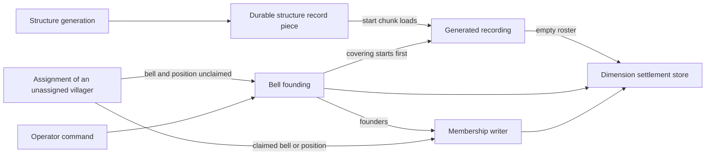
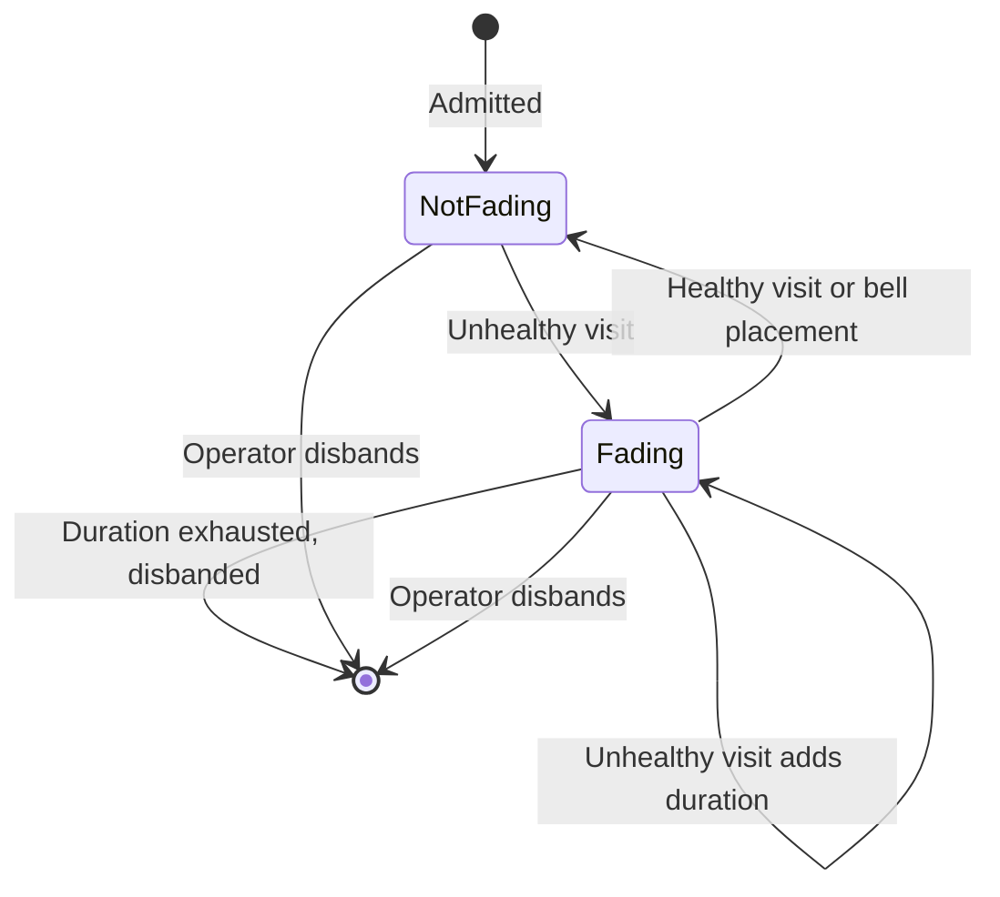

# Settlement Identity and Lifecycle

A settlement is a persistent place with its own identity, character, members, and record of events. Generated
settlements and settlements founded during play participate in the same runtime system.

Identity lives in the settlement's record, not in a bell. The record stores no bell position, every bell in the claim
serves the settlement equally, and replacing one changes nothing. Bells still keep a settlement alive. With decay
enabled, a settlement found with no bell in its claim, or with too few residents, begins to fade; one that keeps fading
is disbanded, deleting its record. A bell placed back in time revives it under the same identity.

This guide covers the relationships between creation, persistence, membership, health, and presentation. Start with
[Settlement][settlement] for the record, [SettlementStore][store] for persistence, and
[SettlementStoreModule][store-module] for server bindings. [Generation](generation/overview.md) owns character and
structure generation; [Player Surfaces](player_surfaces.md) owns the shared HUD rules.

## Authority and persistence

The stable reference to a settlement is its dimension and UUID. A name can change, and generated UUIDs can repeat
across dimensions. Carry the dimension through membership, discovery, and region events, including an exit delivered
after the player has changed levels.

| Question | Authority and relationship |
|---|---|
| Which settlement exists here? | The dimension's store owns the persistent record and chunk claims. |
| Which settlement does a villager belong to? | Its saved membership attachment owns affiliation independently of position. |
| What is known about the population? | The persisted roster projects living membership and each member's last reported census state. |
| Is the settlement healthy? | Nothing stores health. It is assessed on demand from the roster and vanilla's meeting-point data; the record stores only fading progress. |
| Which building is here? | Generated structure pieces carrying the settlement's identity. A founded settlement resolves no buildings, even when founded among structure pieces. |
| What can the client show? | Synced chunk claims and the level directory project server state for presentation. |
| Has this player discovered the settlement? | The player's saved discovery attachment records that relationship on the server. |

Creation, membership, naming, and health each have an application writer, introduced in the sections below. A writer
pairs its change with the log entry and lifecycle notification that belong to it. The store does not enforce this:
[SettlementStore][store] accepts any updated record, so a new kind of write belongs in the writer that owns that part
of the record, never in a direct store call. The persistence implementation is
[SavedDataSettlementStore][saved-store], backed by [SettlementSavedData][saved-data] in each dimension.

## Creation and territory

### Two creation paths, one runtime record

[GeneratedSettlementRecorder][recorder] admits the information carried by a generated start. The
[Minecraft integration guide](generation/minecraft_integration.md) owns the structure-to-recorder handoff. A generated
settlement has no record until its start chunk fully loads, and that moment, not generation, is its recording date. Its
roster and log start empty, and its villagers join through ordinary assignment. Keeping the information with the saved
start makes a missing record recoverable even when generation finishes during shutdown. Loading the start offers it for
recording again; an existing record is retained, and a tombstoned identity is refused. A record rebuilt this way is
dated, named, and clipped at the moment of recording, and carries none of the lost record's runtime changes.

[SettlementFoundingService][founding] is the common entry point for automatic and operator-requested bell founding. An
automatic attempt is made when enough unassigned Settlements villagers share an unclaimed meeting bell in an allowed
dimension; the service then applies the rest of its admission rules. Operator founding applies the same rules except
the resident minimum, so a command can found a settlement too small to be healthy. A generated start covering the site
must be offered for recording before deciding the site is free, or bell founding could create a second identity over
it.

Character generation is shared with worldgen through the
[character entry point](generation/overview.md#orchestration). Bell founding obtains its initial population from an
observed headcount; generation supplies its own starting population. Neither value is the ongoing census. Persisted
character and history are retained across reloads rather than rerolled.

Founding crosses a thread boundary: world reads and admission happen on the server thread, while terrain and character
computation run on a worker. A successful survey does not reserve the world it observed; only a second founding at the
same bell is held off. Bell availability, free territory, naming, and the surviving eligible founders must be checked
again before committing. The founded lifecycle event follows admission of the founders, so its consumers receive the
populated settlement.

Creation origin and historical age answer different questions. A bell-founded settlement inside a recognized village
structure receives an established past, as a generated settlement does. A founding outside one starts its history when
its record begins. The founding service makes that distinction, [SettlementFounding][founding-dates] holds the
resulting dates, and the [history pipeline](generation/pipeline.md#44-history-event-phase) draws and dates the history.

### Claims preserve identity

Territory is a connected set of chunks containing its center. The incumbent keeps a claimed chunk: admission clips a
new claim to free chunks connected to its center and refuses a taken center. A generated settlement whose center is
taken is refused each time its start loads; until the center frees, its structure has no owner and its buildings do not
resolve.
Bell founding also refuses a claim too small to serve as a settlement, while generated recording admits whatever the
clip leaves. These rules preserve the existing settlement's borders when a neighbor appears.

Settlements do not merge on contact. Merging would require decisions about names, histories, logs, and every member's
affiliation; a geometric overlap cannot make those decisions. Claims remain fixed after admission. Any extension that
changes them needs an operation preserving ownership and position lookup together, rather than a generic record
update. [SettlementQueryService][queries] is the entry point for position lookup, including buildings; application
services that need only the claim read the store directly.

## Time, history, and the log

Settlement dates use vanilla day time through [CivilDateTime][civil-time] and [WorldCalendar][calendar]. Founding dates,
dated history, and runtime log entries share that calendar, including sleep and command-driven time changes. A
founding date may precede world creation. Adding an independent settlement calendar would make these dates disagree
with the calendar players see.

The uses of time have different contracts:

| Use | Behavior when world time changes |
|---|---|
| Historical dates | Stored dates remain unchanged; consumers interpreting elapsed age must treat a negative span as recent. |
| Runtime log | Insertion order remains event order even when timestamps run backward. |
| Gathering attendance | An eligible check-in on a nonnegative day different from the previous gathering counts another gathering, including after a rewind. A forward jump does not invent intervening gatherings, and a frozen day cycle counts at most one. |
| Fading | Accumulated loaded simulation duration is independent of calendar jumps. |
| Arrival presentation | Client timing uses a monotonic clock independent of the connected world's time. |

The [settlement log][settlement-log] is a bounded record of runtime facts. Consumers must not sort it by timestamp or
use elapsed calendar days as a reliable event window. Founding history supplies the past before observation; the log
records what happens during play. Only bell founding writes a founding entry, so a consumer cannot rely on one marking
the start of a log. Founders' join entries identify them as founders, and rename entries preserve the previous name, so
consumers need not reconstruct those facts from the current roster or name.

The settlement record is ground truth for settlement-level consumers. It does not grant villagers knowledge of events
they never perceived or heard about. Consumers that inform villagers must establish how they perceived or learned the
information; settlement-wide records cannot stand in for those observations.

## Membership, gatherings, and census

[SettlementAssignmentService][assignment] places unassigned villagers: it joins one to the settlement claiming its
meeting bell or its position, and attempts a founding only when neither is claimed. Once assigned, affiliation survives
travel, unloading, dimension changes, and loss of a bed or workstation. Crossing a border is a position change, not a
membership transition.

[SettlementMembershipService][membership] coordinates attachment changes, roster changes, and member history. The
roster is a persisted index of living Settlements villagers, babies included, not another authority over affiliation.
Vanilla villagers and converted non-villagers can carry the saved reference without appearing on that roster.

Birth, conversion, and removal integrate through different lifecycle hooks:

- Courtship assigns membership after the child has been successfully added and housed, so its first snapshot describes
  the admitted child. Spawn-egg offspring follow ordinary assignment instead of inheriting a parent's affiliation.
- Conversion preserves affiliation while the living roster follows the resulting entity type. A return to a
  Settlements villager uses the new entity UUID. Successful conversion and genuine death need distinct history;
  discarding an entity during conversion must not invent a death. A conversion the conversion handler does not
  recognize drops the row without recording any history.
- Unloading and dimension transfer preserve the row. A permanent removal updates it through the membership writer.

These hooks begin at [BaseVillager][villager], [courtship][courtship], and the
[conversion handler][conversions]; the [villager totem][totem] handles its own conversion path. Entity addition can
repair a returning member before its conversion handler records the return. Repair therefore restores a missing row
silently; otherwise reloads and conversions would create extra join events. Admission to a roster removes the member's
conflicting listings without logging a departure, and the store refuses duplicate member rows within a dimension.

An adult checks in when its brain is in the MEET activity and it stands near its remembered meeting point, which must
lie in its own settlement's claim; standing beside a different bell of the same settlement does not count. A check-in
refreshes the member's census snapshot and attendance mark. Bookkeeping runs whatever behavior executes during MEET, so
a plan never suppresses a check-in the villager is in range for, but a plan that keeps it away from its meeting point
still costs attendance. A social plan can select MEET outside the scheduled meeting time, so gatherings are not
confined to it. Babies do not attend; growing up starts the adult's attendance baseline without counting childhood as
absence.

The roster is the census. Readers derive their counts from its snapshots without loading entities or maintaining a
second aggregate. A snapshot refreshes only on admission, check-in, and growing up, so a member that never checks in
keeps the state it was admitted with. A member's missed gatherings are the settlement's gatherings since its last
check-in or admission, so they measure opportunities to attend, not elapsed time, and a cure or return starts a fresh
count. No gathering is counted without an eligible adult's check-in; when all members are absent or unloaded, no
gathering occurs. Attendance cannot by itself prove that a resident is missing, and absence does not revoke
affiliation.

## Health, fading, revival, and disbanding

The health rule combines living roster membership with bell evidence. Any block vanilla registers as a meeting point
counts as a bell ([SettlementBellRules][bell-rules]). Only roster rows count as members: members away from home and
babies count, while vanilla villagers carrying the settlement's reference do not. Enough members and any bell in the
claim establish health; too few members establish ill health even when bell presence is unknown. With enough members,
finding no bell establishes ill health only when all claimed chunks can be checked. Otherwise the result is
undetermined, and fading neither advances nor clears.

Health inspection avoids loading absent chunks merely to decide whether a settlement should survive. Treating an
unobserved bell as missing would punish a settlement for the player's view distance. The cost is that a missing bell is
established only while the whole claim is loaded at once, so a claim larger than the area kept loaded around players
may never begin fading for want of a bell; too few residents has no such limit. Vanilla's POI data supplies bell
evidence, so block-interaction events do not maintain a competing bell registry, and breaking a bell is noticed only by
a later health visit.

The record stores whether a settlement is fading and for how long; disbanding deletes the record, which the diagram's
end state represents. With decay enabled, health visits run only while simulation is running normally and the level has
a player or a forced chunk, and a visit acts only while the settlement's center chunk is entity-ticking. These gates
govern beginning, advancing, and clearing fading by visit, which keeps decay tied to opportunities for villagers to act.
Accumulated fading is sampled simulation duration, not a calendar deadline or an exact continuous uptime measurement.
Revival discards it, so a later fade starts over. Disabling decay suspends stored fading state: no visit or placement
moves it, and only an operator can disband.

With decay enabled, a bell placed by an entity can revive a fading settlement immediately when its residents suffice.
The placement is evidence before vanilla has registered the bell's POI. That path only revives; letting it advance
fading would allow repeated building actions to accelerate decay. A bell that appears without an entity placing it,
such as through a command, waits for the next healthy visit. [SettlementHealthService][health] owns health changes,
and [SettlementHealthServerEvents][health-events] connects the cadence and placement paths. Clients see fading through
the synced settlement summaries; villager behavior does not read it.

Disbanding deletes the record, including its roster and log. Generated settlements also leave an identity tombstone
in the same saved data as the deletion, preventing the durable structure start from recreating them. Saving deletion
and tombstone together avoids a split between chunk and settlement saves. Founded settlements have no structure record
to recreate them and need no tombstone.

Members reconcile a reference that no longer resolves on load or their membership cadence, becoming unassigned;
disbanding does not scan the world's entities. Vanilla villagers carrying the reference are not reconciled and keep it.
Founding again at the same place creates a new identity rather than restoring the deleted record. The generation origin
does not exempt a settlement from the shared health rule.

## Change propagation

[Store listeners][store-listener] maintain derived state after writes. They see admission, roster updates, fading,
renames, and deletion, including writes that do not represent a lifecycle event. They run before the store call
returns, but have no ordering guarantee relative to each other. A listener must derive its result from the change,
rather than depend on another listener having refreshed a projection. Generated recording can admit a record from inside
a chunk-load callback, so a listener must never load chunks. Initial admission can precede founder membership; store
notifications are not a signal that founding has finished.

[SettlementLifecyclePublisher][lifecycle] connects application writers to NeoForge lifecycle events after the relevant
changes are stored. Use this seam for reactions to a completed founding, recording, rename, or disband; fading has no
lifecycle event. Use store notifications for a projection that must follow every write. The [event package][events]
owns the lifecycle event contracts.

### Client projections

[SettlementClientView][client-view] reads two transient, synced attachments: watched chunks carry their claimant, and
the level directory carries settlement summaries and whether founding is allowed. Neither is saved or used as a server
authority. The directory spans the dimension because rename previews need all occupied names; it contains no settlement
positions. Knowing a name through this projection does not count as discovering its location.

The directory receives a full snapshot when a player joins, respawns, or changes dimension, and incremental changes
afterward. Claim state must be reconciled when a player watches a chunk: a chunk can lose full status and return
without another load event. A load-only update would send stale ownership after a founding or disband. See
[claim synchronization][claim-sync] and [directory synchronization][directory-sync]. These projections, like the arrival
message below, participate in the network compatibility promise described by
[P18](../standards/platform.md#p18--payload-negotiation-compares-a-version-string-never-the-codecs).

While a player holds an item in `#settlements:shows_settlement_borders`, [SettlementBorderRenderer][border-renderer]
draws the outlines of nearby claims on the ground, reading only these projections. A chunk the client does not hold
reads as unclaimed through `claimAt`, so the outline draws no edge toward one: the claim may continue there, and an edge
would show a false border along the edge of loaded terrain. Touching settlements each draw their own edge inside their
own claim. The outline is read again on a short interval rather than on block and claim changes, so it trails those
changes briefly. Cartographers' idle lines in [DialogueLineIndex][dialogue-index] are the only in-world hint that the
view exists; removing them leaves it undiscoverable.

### Region changes

[PlayerSettlementTracker][tracker] connects movement and lifecycle changes to region events and owns their ordering
contract. New settlements must reach players already standing inside their claims. Founding and recording rechecks wait
until the end of the server tick, outside recording's chunk-load callback, where a building lookup could load another
chunk and deadlock. Disband exits happen immediately using the removed record, before another
movement update can forget which settlement the player occupied.

Transitions publish exits before entries. Building exits precede their settlement exit, and settlement entries precede
building entries, so consumers never observe a building arrival before its enclosing settlement. The cause travels
with the event ([SettlementRegionCause][region-cause]): moving into a place, recording it, founding it around a player,
and disbanding it need different presentation. Logging in, respawning, and changing dimension count as movement and
publish entries for wherever the player lands. Logout publishes no exits, so a consumer pairing entries with exits must
treat logout as leaving.

## Bell interactions, arrival, and discovery

A named bell can supply a founding name; placing a named bell inside an existing claim does not rename that
settlement. Renaming happens only through a name tag used on a bell in the claim. [SettlementNamer][namer] is the only
writer of a stored name and resolves conflicts within the dimension. Keeping the settlement's name independent of bell
names prevents two bells in one claim from presenting competing identities.

The [bell hover][bell-hover] shows the claimed settlement and its fading status, or a founding cue on an unclaimed bell,
and previews the rename a main-hand name tag would make. The [interaction handler][name-tag] uses the same naming rule
on the server and respects build permission and item-use denials. The preview is a prediction from synced state, so a
concurrent server change can alter the result.

[SettlementArrivalAnnouncer][announcer] decides which settlement moment a player receives;
[SettlementAnnouncementType][announcement-type] defines the moments and who receives each.
[PlayerSettlementDiscoveries][discoveries] persists discovery by dimension and identity across death and renaming. That
record is server-only and never synced. Login prunes discoveries of settlements that a loaded dimension no longer
stores. Spectators receive no moments and record no discoveries. A founding around a player gets its founding
announcement; recording a generated settlement participates in ordinary discovery. Rename emphasis belongs to the
player who renamed it, while the name update reaches the other clients through synchronization. Founding around a
player and renaming both count as that player's discovery.

Arrival messages carry the information needed to display their moment. In particular, disband presentation cannot
depend on looking up a summary that has just been removed. The client owns queuing, re-entry suppression, and delayed
departure display. Discovery is recorded when the server announces it, not when the client shows it. The client starts
a pending discovery only when the HUD can show it, but can still drop it unshown, so the record and what the player saw
can disagree. [SettlementArrivalHudRenderer][arrival-hud] draws each moment as a title at the top center of the screen
and plays any sound the moment carries. It follows the shared suppression rule in
[Player Surfaces](player_surfaces.md#when-no-hud-region-draws).

## Contributor seams and current limits

Use [SettlementsCommand][command] to inspect the persisted record and roster alongside current health evidence. Its
founding and disband actions use the application services, keeping operator actions on the same lifecycle paths.

For configuration changes, start at [SettlementFoundingConfig][founding-config],
[SettlementDecayConfig][decay-config], and [SettlementTitleConfig][title-config]. Naming content enters through
[SettlementNamePoolDataManager][name-data]; character and history content belong to the
[generation extension guide](generation/datapack_extensions.md). Values and formats stay with those authorities.

Consumers must account for the limits of the available evidence. A villager deleted externally while unloaded can leave
a stale roster row; the roster is not a live entity census. A stale row still counts toward health, so it can keep a
settlement alive. Missed gatherings have no automatic missing-person classification. Entity UUID changes across
conversions also prevent treating log subjects as stable person identities. A feature requiring that continuity needs a
person identity before it can join those records reliably.

The settlement log, character, region events, and discovery record are extension seams. Reading them does not imply
that chronicles, deliberate migration, claim growth, or a discovery journal already exist. Keep such consumers separate
from the persistence and observation responsibilities described here.

[settlement]: ../../src/main/java/dev/breezes/settlements/domain/settlement/model/Settlement.java
[store]: ../../src/main/java/dev/breezes/settlements/application/settlement/persistence/SettlementStore.java
[store-module]: ../../src/main/java/dev/breezes/settlements/di/modules/server/SettlementStoreModule.java
[saved-store]: ../../src/main/java/dev/breezes/settlements/infrastructure/minecraft/persistence/SavedDataSettlementStore.java
[saved-data]: ../../src/main/java/dev/breezes/settlements/infrastructure/minecraft/persistence/SettlementSavedData.java
[recorder]: ../../src/main/java/dev/breezes/settlements/application/settlement/persistence/GeneratedSettlementRecorder.java
[founding]: ../../src/main/java/dev/breezes/settlements/application/settlement/founding/SettlementFoundingService.java
[founding-dates]: ../../src/main/java/dev/breezes/settlements/domain/settlement/model/SettlementFounding.java
[queries]: ../../src/main/java/dev/breezes/settlements/application/settlement/query/SettlementQueryService.java
[civil-time]: ../../src/main/java/dev/breezes/settlements/domain/world/CivilDateTime.java
[calendar]: ../../src/main/java/dev/breezes/settlements/domain/world/WorldCalendar.java
[settlement-log]: ../../src/main/java/dev/breezes/settlements/domain/settlement/model/SettlementLog.java
[assignment]: ../../src/main/java/dev/breezes/settlements/application/settlement/membership/SettlementAssignmentService.java
[membership]: ../../src/main/java/dev/breezes/settlements/application/settlement/membership/SettlementMembershipService.java
[villager]: ../../src/main/java/dev/breezes/settlements/infrastructure/minecraft/entities/villager/BaseVillager.java
[courtship]: ../../src/main/java/dev/breezes/settlements/application/ai/behavior/usecases/villager/courtship/CourtshipInitiateBehavior.java
[conversions]: ../../src/main/java/dev/breezes/settlements/bootstrap/event/VillagerConversionServerEvents.java
[totem]: ../../src/main/java/dev/breezes/settlements/infrastructure/minecraft/items/VillagerTotemItem.java
[bell-rules]: ../../src/main/java/dev/breezes/settlements/application/settlement/bell/SettlementBellRules.java
[health]: ../../src/main/java/dev/breezes/settlements/application/settlement/health/SettlementHealthService.java
[health-events]: ../../src/main/java/dev/breezes/settlements/bootstrap/event/SettlementHealthServerEvents.java
[store-listener]: ../../src/main/java/dev/breezes/settlements/application/settlement/persistence/SettlementStoreListener.java
[lifecycle]: ../../src/main/java/dev/breezes/settlements/application/settlement/lifecycle/SettlementLifecyclePublisher.java
[events]: ../../src/main/java/dev/breezes/settlements/infrastructure/minecraft/event/settlement/
[client-view]: ../../src/main/java/dev/breezes/settlements/infrastructure/minecraft/attachments/SettlementClientView.java
[claim-sync]: ../../src/main/java/dev/breezes/settlements/bootstrap/event/SettlementClaimSyncServerEvents.java
[directory-sync]: ../../src/main/java/dev/breezes/settlements/bootstrap/event/SettlementDirectorySyncServerEvents.java
[border-renderer]: ../../src/main/java/dev/breezes/settlements/infrastructure/rendering/border/SettlementBorderRenderer.java
[dialogue-index]: ../../src/main/java/dev/breezes/settlements/application/ai/dialogue/DialogueLineIndex.java
[tracker]: ../../src/main/java/dev/breezes/settlements/bootstrap/event/PlayerSettlementTracker.java
[region-cause]: ../../src/main/java/dev/breezes/settlements/infrastructure/minecraft/event/settlement/SettlementRegionCause.java
[namer]: ../../src/main/java/dev/breezes/settlements/application/settlement/naming/SettlementNamer.java
[bell-hover]: ../../src/main/java/dev/breezes/settlements/presentation/ui/hud/SettlementBellLookTargetHudProvider.java
[name-tag]: ../../src/main/java/dev/breezes/settlements/bootstrap/event/SettlementNameTagEvents.java
[announcer]: ../../src/main/java/dev/breezes/settlements/bootstrap/event/SettlementArrivalAnnouncer.java
[announcement-type]: ../../src/main/java/dev/breezes/settlements/infrastructure/network/features/arrival/packet/SettlementAnnouncementType.java
[discoveries]: ../../src/main/java/dev/breezes/settlements/infrastructure/minecraft/attachments/PlayerSettlementDiscoveries.java
[arrival-hud]: ../../src/main/java/dev/breezes/settlements/presentation/ui/hud/SettlementArrivalHudRenderer.java
[command]: ../../src/main/java/dev/breezes/settlements/presentation/commands/SettlementsCommand.java
[founding-config]: ../../src/main/java/dev/breezes/settlements/application/settlement/founding/SettlementFoundingConfig.java
[decay-config]: ../../src/main/java/dev/breezes/settlements/application/settlement/health/SettlementDecayConfig.java
[title-config]: ../../src/main/java/dev/breezes/settlements/presentation/ui/hud/SettlementTitleConfig.java
[name-data]: ../../src/main/java/dev/breezes/settlements/infrastructure/minecraft/data/naming/SettlementNamePoolDataManager.java
