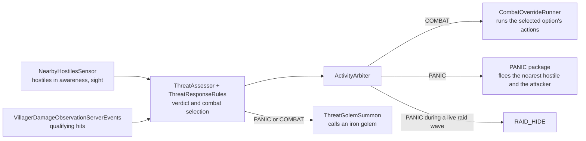

# Threat Response

How a villager notices hostiles and hits, decides whether to fight, flee or carry on, and carries that decision out.

The machinery the response rides on is shared with the rest of villager life and documented in
[`behavior_orchestration.md`](behavior_orchestration.md): where the assessment sits in the villager's AI step, how
`ActivityArbiter` turns a verdict into an activity, and how the override lane installs, preempts and stops runners.
This document owns everything threat-specific on top of it.

---

## Overview

Each assessment produces a `ThreatVerdict` — **COMBAT**, **PANIC** or **HOLD** — and, for COMBAT, a
`CombatSelection`: the option the villager fights with and its target. The verdict decides the activity; the activity
gates the day plan and the override lane, so one judgment of danger decides everything the villager does about it.

**Files:**

- `application/ai/sensors/NearbyHostilesSensor.java` and `bootstrap/event/VillagerDamageObservationServerEvents.java`
  — the evidence.
- `application/ai/threat/` — `ThreatAssessor` (reads the world, records the result), `ThreatAssessmentState` (one
  villager's evidence and assessment history, reached through `IVillagerBrain.threats()`), and the combat option
  contract.
- `domain/ai/threat/` — `ThreatResponseRules`, which decides over plain scalars carried by `ThreatSituation`, and the
  hit, decision and verdict types.
- `application/ai/override/CombatOverridePolicy.java` and `CombatOverrideRunner.java` — combat execution.
- `infrastructure/minecraft/behavior/threat/` — `ThreatGolemSummon`, the iron golem summon,
  `ThreatGolemSummonConfig`, its server settings, and `FleeTowardVillage`, the panic flee.

Everything here is transient except the golem summon's cooldown. Nothing else is saved with the villager, so after a
load it holds until its first assessment decides from scratch.

---

## Evidence

### Hostiles in awareness

`NearbyHostilesSensor` (a mod-native sensor; see
[`behavior_system.md`](behavior_system.md#sensors-the-read-side)) finds the live members of the
`settlements:villager_enemies` entity tag within the villager's awareness radius, nearest first, and writes four
memories:

| Memory | Holds |
|---|---|
| `NEARBY_HOSTILES` | Every hostile in awareness |
| `SIGHTED_HOSTILES` | Those of the nearest few that are in sight |
| `UNSEEN_HOSTILES` | Those of the nearest few that are out of sight |
| `NEAREST_HOSTILE` (vanilla) | The nearest hostile in awareness, seen or not |

Sight is checked only for the nearest few, under the sensor's own budget; a hostile past it is in neither sight list and
counts as *unchecked*. Awareness is the villager's own reach and says nothing about how dangerous a hostile is; that
is the threat weight, below. Its reach is capped by the vanilla living-entity scan the sensor reads; the sensor's TODO
records the replacement.

`NEAREST_HOSTILE` exists for vanilla's flee. A villager can panic at anything in awareness, so the flee target has to
come from the same awareness rather than from vanilla's own, shorter hostile sensor, which the villager does not run.

### Hits

`VillagerDamageObservationServerEvents` observes `LivingDamageEvent.Post` on the server. A hit **qualifies** unless its
damage type is in `settlements:does_not_alarm_villagers` (a cucco's peck), the villager hurt itself, there is no living
attacker (a fall, fire), or it cost no health. A qualifying hit:

- is recorded on the villager's threat state as a `QualifyingHit`, replacing any earlier one. Hits are judged one at a
  time and never summed, so a run of small hits never reads as one large one;
- makes an assessment due at once rather than at the next cadence;
- names its attacker in vanilla's `HURT_BY_ENTITY` memory, expiring with the hit, so the flee only ever runs from an
  attacker whose hit counted. Nothing erases that memory when the attacker dies, so a villager may flee a dead
  attacker's last position until the hit lapses.

Damage that does not qualify neither alarms the villager nor steers its escape.

---

## The assessment

### When it runs

`ThreatAssessor.tick` runs every villager tick from `VillagerBrain.preVanillaAiStep()`, ahead of `ActivityArbiter`, so
the activity answers the verdict made that tick. It assesses only when due: on a staggered cadence, when a hit was
recorded, or when the sensed hostiles changed. A trigger other than the cadence restarts the cadence, so a villager with
hostiles near does not also assess on the cadence's original phase.

With no hostile in awareness, no live hit and no response under way, the rules can only hold, so the assessor records
HOLD without scoring. That shortcut is the whole cost of the response for a peaceful villager.

### Three judgments

The assessor reduces the world to a `ThreatSituation` of scalars; `ThreatResponseRules` decides from that alone. The
application owns every world read and every entity reference; the domain owns the thresholds and their order.

- **Danger** decides whether the villager must respond at all. Each aware hostile contributes its threat weight,
  falling off linearly with distance to nothing at danger's own reach. That reach is independent of the awareness
  radius, so widening awareness does not make villagers more fearful.
- **Nerve** decides fight or flee: the villager's WIL gene, its health fraction and the option's own contribution,
  against the summed threat weight of every aware hostile. Distance stays out of nerve, so a fighter closing on its
  target does not rout itself by approaching.
- **Engagement** decides whether fighting is possible at all. Entering a fight needs a sighted hostile, within an
  option's reach of the villager, that a registered `CombatOption` can engage. Continuing one needs the option still
  able to fight, a hostile still in awareness, a held lock or a live hit, and an engageable or locked-on target within
  the targetless limit.

**Threat weight** is per entity type, from the `settlements:threat_weights` data map. A tagged enemy with no entry
takes `ThreatAssessor`'s default weight; a weight of zero leaves a hostile aware but harmless, and the codec rejects a
negative one.

**Unseen hostiles weigh less.** A hostile known to be out of sight carries only a fraction of its weight, in danger and
nerve alike (`ThreatAssessor.UNSEEN_THREAT_FRACTION`): a villager cannot fear what it cannot see, and the remainder
stands for what it hears. An unchecked hostile counts in full, so a large visible group is never discounted as hidden.

**A zombie villager being cured is never a target**, for any option: the patient is a villager in the making. It still
counts toward danger and nerve, since vanilla villagers flee one too.

**Babies never fight.** A baby has no override lane to run a fight in, so the assessor never offers it an option; it
panics or holds.

### The rules

`ThreatResponseRules.decide` is the authority on the order. The orderings that carry weight, and why:

- **Continuing a fight is judged before entering one.** The previous option keeps fighting at a lower nerve bar than
  entry, so a committed fighter is not sent running by a small loss of confidence, and an available alternative never
  displaces a fight that should have continued. Only a villager whose previous verdict was COMBAT can continue; a
  routed villager re-enters through the entry bar. No entering option can change a fight that continues, so the
  assessor searches for one only when `ThreatResponseRules.continues` says the fight does not.
- **Fighting is judged before fleeing.** A capable fighter engages a sighted hostile whether or not the area is
  dangerous, and healing can lift a panicked villager back into the fight.
- **Panic** answers danger at or above its threshold, or a live hit.
- **A panic lingers** after it stops being alarming, for a short spell while a hostile remains in awareness (below).
- Otherwise the villager **holds**, and HOLD clears the selection.

### Hysteresis

Two bands, each keyed only on the previous verdict:

| Judgment | From COMBAT | From PANIC | From HOLD or none |
|---|---|---|---|
| Nerve | continue at the lower bar | enter at the higher bar | enter at the higher bar |
| Danger | calm threshold | calm threshold | alarm threshold |

The entry bar sits above the continue bar and the alarm threshold above the calm one; those orderings are what stop a
hostile loitering at a threshold from flipping the verdict. Two clocks cover what a band cannot:

- **The targetless limit** (`ThreatResponseRules.TARGETLESS_COMBAT_LIMIT`) ends a fight that has gone too long without
  an engageable or locked-on target, live hit or not. Momentary loss of sight therefore does not end a fight, but a
  hostile the fighter can never engage — one in a cave below, a drowned underwater, a patient — cannot hold it in
  COMBAT. The clock runs on an *engageable* target rather than on a sighting, because the fighter never moves to reach
  one: a hostile it sees but cannot hit stalls it just the same. Under a live hit the fight then falls through to PANIC,
  so a villager shot by an attacker it cannot engage flees instead of standing.
- **The panic linger** (`ThreatResponseRules.PANIC_LINGER`) keeps a panicked villager panicking for a spell after its
  last alarming assessment while a hostile stays in awareness. A chaser defeats the danger band on its own: it re-closes
  the gap between the calm and alarm distances within seconds, so without the linger a chased villager would stop the
  moment it crossed the calm distance and flip between PANIC and HOLD for the length of the chase. Only an alarming
  assessment restarts the clock (`ThreatDecision.PANIC`, never `LINGER_IN_PANIC`), so a lingering panic cannot sustain
  itself, a hostile closing in fires the alarm again, and with nothing left in awareness the villager calms at once.
  The linger only ever turns a HOLD into PANIC.

Beyond those, the previous verdict, the previous selection and the fight's lock (below) are the only history; there is
no episode flag.

### The selection

Only COMBAT carries a `CombatSelection`. The fight's **lock** is the latest target a selection named. The villager's
`ThreatAssessmentState` keeps it through assessments that name no target, and drops it when the verdict leaves COMBAT.
The lock belongs to the fight rather than to one option, so an option that takes over the fight inherits the target.

Whichever option an assessment judges, continuing or entering, it prefers the lock when that option can engage it:
through `canEngage` when the villager has the lock sighted within the option's reach, or, for the continuing option
only, through `CombatReadiness.canStayLockedOn` when the option perceives the target by its own means, whether or not the
villager's awareness or sight still holds it. A crewed machine does, seeing from where it stands. The lock outranks a
fresh target, so a fighter finishes one target rather than switching to whichever hostile is nearest on every
assessment, which for a machine means slewing it and walking its operator between stations. The exception is an
engageable hostile at close quarters (`ThreatAssessor.CLOSE_QUARTERS_BLOCKS`), which threatens the fighter itself. A
lock already held at close quarters is kept, so two hostiles jostling there do not swap the target. When the option
cannot engage the lock, the target is the nearest sighted hostile it can engage, and that hostile becomes the lock.

An assessment names the lock only when it confirms the lock is engageable. A lock named unconfirmed would launch an
action that refuses to start, and the revocation would make the next assessment name it again, on every tick. A lock
that cannot be confirmed leaves the fight targetless, toward the targetless limit, until the target is engageable
again.

A lock carries the target's id, never the entity: each assessment resolves the id from the level and never selects a
target that has died, so a fighter that kills its target while a second hostile waits behind a wall fights on
targetless rather than chasing a dead entity's id. A locked target beyond awareness adds nothing to danger or nerve;
it is far, and both weigh what is near.

Entry takes the first option that can engage, in the precedence `CombatOptionModule` lists them; a stronger option
belongs ahead of a weaker one. Precedence outranks the lock: the lock only decides which target an option takes.

A selection whose action refuses to start is **revoked**: the verdict stays COMBAT, the villager has no selection, and
an assessment is due at once. What keeps that assessment from choosing the same thing again is the option's own
checks, since only the option knows what its action needed.

---

## Responding

### From verdict to activity

`ActivityArbiter` turns the verdict into an activity: COMBAT to `COMBAT` ahead of every raid row, PANIC to `RAID_HIDE`
during a live raid wave and to `PANIC` otherwise. The full precedence, and why the arbiter erases movement and
interaction targets on entering PANIC or COMBAT, are in
[`behavior_orchestration.md`](behavior_orchestration.md#activity-arbitration). The assessment has no raid input: where
a frightened villager goes during a raid is the arbiter's decision, not the verdict's.

Either response suspends the day plan, and the interrupted slot is retried once the plan resumes, unless its window
has closed by then.

### Panic

PANIC runs the flee in `VanillaBehaviorPackages.getPanicPackage`, fed by this response rather than by vanilla's
sensors: it runs from `NEAREST_HOSTILE` and from the `HURT_BY_ENTITY` of a live qualifying hit. Each flight heads
toward the village in any direction but straight at the threat, passing a threat that stands in the way: fleeing
straight away, as vanilla's flee does, lets a slower chaser herd the villager out of the village. `FleeTowardVillage` replaces vanilla's flee for that preference. The package leaves out vanilla's
own panic trigger and calm-down; the arbiter enters and leaves PANIC with the verdict. The golem summon that trigger
carried is a behavior of its own, under [Calling a golem](#calling-a-golem).

### Combat

The assessment decides *whether* and *with what* a villager fights; the override lane carries it out. While the verdict
is COMBAT, `CombatOverridePolicy` (`EMERGENCY`, admitted only during `COMBAT`) requests a fresh
`CombatOverrideRunner`. The runner reads the villager's selection every tick and ends on the tick the verdict leaves
COMBAT, so entry waits for the next policy evaluation while withdrawal waits for nothing.

- **One action at a time.** An action is an ordinary `IBehavior` that the selected option creates aimed at the target.
  The runner keeps a running action while the selection's option and target are unchanged. A selection with no target
  leaves the action to its own checks, so an action whose target is out of sight may hold its aim until the target
  returns. The targetless limit bounds that wait, since the fight ends there; an action that gives up on a hidden
  target sooner, as the ballista's does, reads `ThreatResponseRules.TARGETLESS_COMBAT_LIMIT` rather than a grace of its
  own, so the two spans cannot drift apart. The runner
  stops a finished, superseded or overrunning action completely before launching the next, so two actions never hold
  the villager at once and a replaced action has released its navigation, held items and animation.
- **Ownership is held between actions.** The runner stays installed, and with it `PLAN_BEHAVIOR_ACTIVE`, so neither the
  day plan nor a trade slips in for a tick between two attacks.
- **Time is bounded per action.** Each action has its own ceiling, reset on replacement; the fight as a whole has none
  and lasts exactly as long as the verdict.
- **A refused start revokes the selection.** The runner checks a new action's preconditions before starting it. An
  action that fails them could not take what it needs, such as a shared weapon, so the runner revokes the selection
  rather than relaunch the same stale choice on every tick.
- **No action, no target in reach, or a revoked selection.** The runner only turns the villager to face the nearest
  aware hostile. Nothing moves it: `COMBAT`'s activity package is empty.
- **Villagers keep talking.** The runner claims `MOVEMENT` and `INTERACTION` only, so social cues on other channels
  still fire mid-fight, and the `COMBAT` activity has a dialogue occasion of its own.
- An action that throws ends the runner; the policy installs a fresh one at its next evaluation while the verdict
  holds. Removal, unload and a brain refresh stop it through the lane's `forceStop`.

Combat options are registered in `di/modules/server/CombatOptionModule.java`, the authority on membership and
precedence. Their actions belong to no behavior catalog entry and no day-plan pool.

### Calling a golem

`ThreatGolemSummon`, a CORE behavior, summons an iron golem for a villager whose verdict is PANIC or COMBAT. It reads
the verdict rather than the activity, so a villager sheltering in `RAID_HIDE` or fighting in `COMBAT` calls for a golem
as a fleeing one does. That matches vanilla, whose summon rides a CORE trigger that fires in any activity.

Past the verdict, the villager and enough Settlements villagers near it must each want a golem: each has slept
recently, by vanilla's rule, and none is cooling down. The summon also stops once enough members of
`settlements:village_guardians` are near. Both counts come from the villager's vanilla nearby-entity scan rather than a
search of the summon's own. The golem is placed as vanilla places one. Every villager in the quorum then draws a long
cooldown for itself, and every other Settlements villager around the summon a short one, so the golems a threat earns
arrive one after another rather than all at once. A cooldown is only ever extended, never cut short, and it is saved
with the villager.

Vanilla villagers never join the quorum, since they cannot hold the cooldown; they keep vanilla's own summons. The
gossip summon that the meet and idle packages keep stays vanilla's too: it still waits for no golem seen lately, so only
a threat takes a village past one golem. A threat summon marks the new golem as seen for the villagers around it, which
holds the gossip summon off.

The golem's target is the attacker in the villager's `HURT_BY_ENTITY`, so only one whose hit qualified, or without a
live hit the nearest hostile in `SIGHTED_HOSTILES` close to the villager. It is never a player, a member of
`settlements:villager_allies`, or a mob the golem itself refuses to fight, and with no target the golem picks its own.
The golem is aimed at its target, and when the target stands close to the villager it is first tried beside the
target, falling back to vanilla's placement around the villager.

---

## Extending

These seams are the contract; each owning file is the authority on what is in it today. The first five are datapack
data, so a modpack extends them without code.

| To | Change |
|---|---|
| Make a mob a villager enemy | The `settlements:villager_enemies` entity type tag |
| Make it more or less dangerous | Its entry in the `settlements:threat_weights` data map; zero makes it harmless |
| Keep a damage type from alarming villagers | The `settlements:does_not_alarm_villagers` damage type tag |
| Let combat projectiles pass a friendly mob | The `settlements:villager_allies` entity type tag |
| Count a mob toward the golem summon's cap | The `settlements:village_guardians` entity type tag |
| Retune the golem summon's cap, quorum or cooldowns | `ThreatGolemSummonConfig`, the `threat_golem_summon` section of the features config |
| Give villagers a new way to fight | A combat option, below |

### Adding a combat option

1. Implement `CombatOption`: its reach from the villager and nerve contribution, `prepare(villager)` returning a
   `CombatReadiness` or null, and `createBehavior(target)` returning a fresh, unstarted action. `EggCombatOption` is
   the reference. `prepare` and the readiness's `canEngage` are read-only: they never build a behavior, start a
   cooldown or acquire anything. An option that perceives targets by its own means may also override the readiness's
   `canStayLockedOn`, as read-only as the others.

   The assessor prepares each option at most once per assessment and asks the readiness about every hostile it
   judges, so work that depends only on the villager — eligibility, inventory, which machines it can use — belongs in
   `prepare`, and `canEngage` keeps only what depends on the hostile. A null readiness spares the option every
   per-hostile check. The readiness may hold world references, so nothing keeps it past the tick.
2. Write the action as an ordinary `IBehavior` whose stop releases everything it took — navigation, held items,
   animation — since the combat runner may replace it at any tick. Keep it out of the behavior catalog and every pool.
   An action that moves the villager navigates at `NavigationType.RUN` or faster, so a fighter never moves at its
   everyday walking pace.
3. Add the option to `CombatOptionModule`'s list, at its precedence among the others.

An option whose action must take something shared when it starts, such as a machine, has the action refuse its start
by failing its preconditions, and records what was refused where the option's own checks will see it, so they decline
it for a while. `BallistaCombatOption` and `ManBallistaBehavior` are the reference.

An option that holds locks must let its action start against anything the assessment could approve, a locked-on target
included, and its `reachBlocks` must cover a locked-on target too, or the runner never launches against one while the
lock keeps the fight going. An action held to the entry checks refuses a locked-on target, the refusal revokes the
selection, and the next assessment holds the same lock and selects it again, on every tick. The ballista pair is the
reference here as well.

---

## Explicit Design Decisions

| Decision | Choice | Rationale |
|---|---|---|
| One assessment decides every response | A single verdict per villager, read by the activity arbiter | Separate panic and combat triggers disagree about the same danger; one judgment, applied in a fixed order, cannot. |
| Verdict and activity are separate decisions | `ThreatAssessor` decides the verdict, `ActivityArbiter` the activity | Raids, bells and the day plan also compete for the activity. Keeping them out of the assessment leaves it one question — how threatened is this villager — and gives the activity one owner. |
| The rules see only scalars | `ThreatSituation` in, `ThreatDecision` out | World reads and entity identity stay in the application and the domain holds only the thresholds and their order, so no mirror of the world has to be kept in step with it. |
| Distance is in danger, not in nerve | Danger falls off with distance; nerve weighs only how many and how strong | Whether to respond depends on how close the hostiles are; whether to fight depends on the odds, which closing in does not change. |
| Sight gates entry, not continuation | Continuation needs awareness, a held lock or a live hit, within the targetless limit | A fighter should not drop its fight the instant its target steps behind a wall, nor start one against a hostile it cannot see. |
| A lock outlasts awareness, but never acquires | An option's readiness may vouch for the fight's lock through `canStayLockedOn`, beyond the villager's sight; only an engageable hostile at close quarters outranks the lock | A machine's reach far exceeds the villager's senses, and ending its fights at the edge of awareness wastes it. Acquiring that far would need a wider awareness, which a nerve summed over every aware hostile cannot survive, so acquisition stays inside awareness and sight. The lock comes first because switching targets on every assessment slews a machine and walks its operator between stations; a hostile at close quarters still takes over, since it threatens the fighter itself. The lock carries an id resolved and liveness-checked on every assessment, so a dead target is never chased. |
| The lock belongs to the fight | `ThreatAssessmentState` holds it until the verdict leaves COMBAT, not the selection or the combat runner | A lock carried in the selection is lost to the first assessment that cannot confirm it, so a target that steps behind cover is no longer preferred when it steps back out. The combat runner is replaced when a fight resumes after an action throws, and only carries a selection out; the assessor, which chooses targets, owns the threat state. The fight's own clock, the targetless limit, already bounds how long an unconfirmed lock lasts, so the lock needs no expiry of its own. |
| A fight without an engageable target ends | The targetless limit, even under a live hit | With awareness alone, a hostile the villager can never reach holds it in COMBAT indefinitely, and COMBAT outranks even sleep. |
| A panic lingers only from PANIC, while a hostile is aware | Rule order: after the alarm, before HOLD | A wider calm band only lengthens each cycle against a chaser; treating a hostile that targets the villager as alarming pins PANIC behind a fence-stuck chaser with no limit of its own. |
| Hits are judged one at a time | The latest qualifying hit replaces the last | Summing hits makes a run of small ones look like one large one. A damage-type tag, not a damage threshold, exempts harmless sources such as a cucco's peck, because a threshold would also ignore a real attacker's small hit. |
| Enemies, weights and exemptions are data | Entity and damage type tags, and a data map | Modpacks add mobs; each new hostile should need a datapack entry, not code. |
| A fight is one override, not one per action | `CombatOverrideRunner` holds the villager across successive actions | Releasing the villager between actions would let the day plan or a trade take it for a tick mid-fight, and a same-tier override never replaces a running one, so per-action overrides would need preemption rules of their own. |
| A refused start revokes the selection | The runner revokes it and makes an assessment due; the option remembers what was refused | Relaunching the same choice would be refused again on every tick. Only the option knows what its action needed, so remembering the refusal is the option's part and the runner treats every option alike. |
| Combat precedence is a list position | `CombatOptionModule` lists the options strongest first; an option declares no rank of its own | Precedence compares options, so no one option can state it: a rank number on each means nothing until read against every other option's, and two equal numbers leave the order to chance. |
| Combat actions stay out of the catalog and pools | Each `CombatOption` creates its own action | A day plan must never schedule an emergency-only action, and an option's availability checks run on every assessment, so they must be read-only, which building and validating a catalog behavior is not. |
| An option is prepared once per assessment | `CombatOption.prepare` returns a `CombatReadiness` that judges each hostile, or null | Most villagers can use no machine, and an operator's setup — eligibility, inventory, the machines it can use — does not depend on the hostile; a check asked per hostile would pay it once per sighted hostile. One readiness answers both "can it fight at all", which continuation needs, and "can it engage this one", which entry needs, so the two cannot disagree. |
| Combat eggs only hinder | Slowness and knockback, no damage | A nitwit cannot tell a raider from a farm zombie, so a volley that cannot kill keeps a misdirected one harmless. |
| The golem summon reads the verdict | A CORE behavior gated on PANIC or COMBAT, not a member of the PANIC package | The arbiter turns PANIC into `RAID_HIDE` during a raid, and COMBAT is an activity of its own; a summon in the PANIC package would never fire for a sheltering villager or a fighter, both of which vanilla summons for. |
| A summoned golem never targets a player | Players are left to vanilla's reputation-driven village defense | Aiming the golem at any player attacker makes one stray hit, such as a sweep in a crowded fight, enough to set a golem on them, where vanilla waits until the village has turned against that player. |
| A golem is called beside its target | Placement beside a close target first, then vanilla's around the villager, from one shared budget of attempts | A golem placed among the villagers has to walk to a skeleton or pillager shooting from range. Only a hostile in sight qualifies, so none is called into a cave below the village. Close keeps the golem within the village it defends, and its placement's block reads within chunks the villager keeps loaded, where a read cannot load one. The budget is vanilla's, so a failed placement costs no more than vanilla's summon. A golem called beside a hostile outside a village wall can stay outside it. |
| A cooldown, not golem sight, paces the threat summon | Each quorum member cools down after a summon, and a cap on nearby guardians stops it | Vanilla's no-golem-seen check holds a village at one golem, too few against a raid. The cooldown is also what limits an iron farm, deliberately well below vanilla's rate; a farm built for vanilla's rate needs vanilla villagers, whose summons stay vanilla. |
| The summon cooldown is saved | Its memory carries a codec, unlike the rest of the threat state | Unsaved, a reload clears every cooldown, and reloading the area would buy a fresh round of golems. |
| A summon cools down the villagers around it | A short cooldown for every Settlements villager near the summon, in the same memory as the quorum's | Without it, a crowd of willing villagers spends its quorums within seconds of a threat and the cap's golems arrive at once. One memory works because a write only ever extends the cooldown; overwriting would let a bystander's short cooldown cut a quorum member's long one short, and writing only when none is present would leave a bystander with seconds to go free to join the very next summon. |
| The guardian cap reads the nearby-entity scan | The list the villager's vanilla scan already keeps, not a search per attempt | The list costs nothing more. It can lag the world by up to one refresh; the short cooldown outlasts that for every villager around a summon, so only one beyond the summon's reach can see room for one more and put a village one over the cap, and that overshoot is accepted. |
